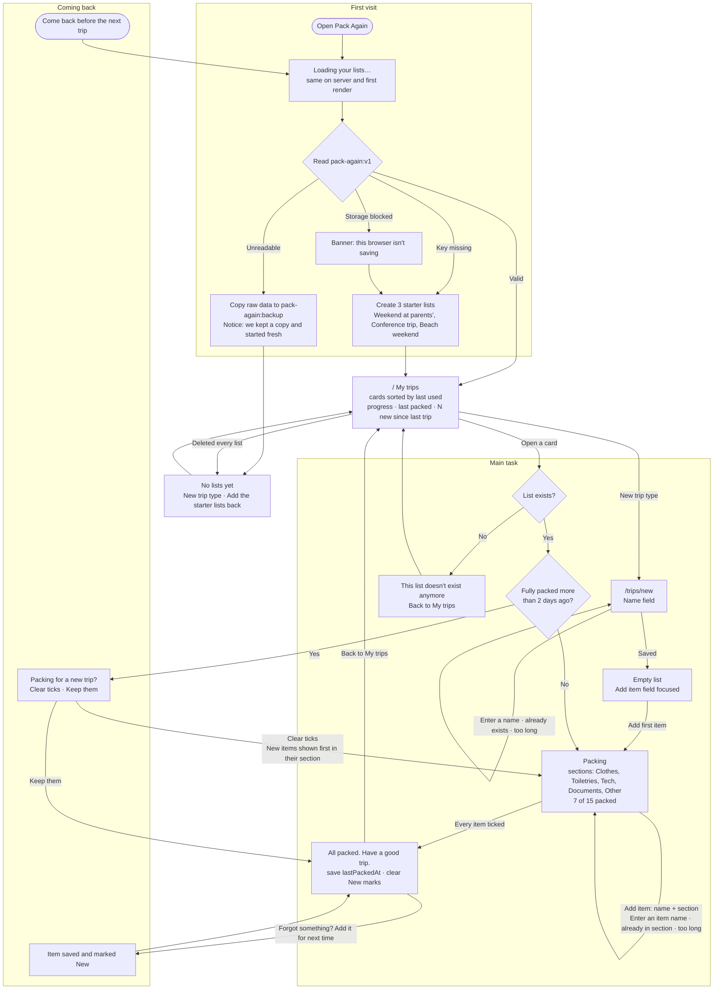

# Pack Again

Packing lists for trips you repeat. Pick a trip type, tick items off as you pack, and find the list waiting for you before the next trip. Data stays in your browser (localStorage).

## Flows

Source and notes: [flows.md](flows.md).



## Run locally

```bash
npm install
npm run dev
```

Open http://localhost:3000.
