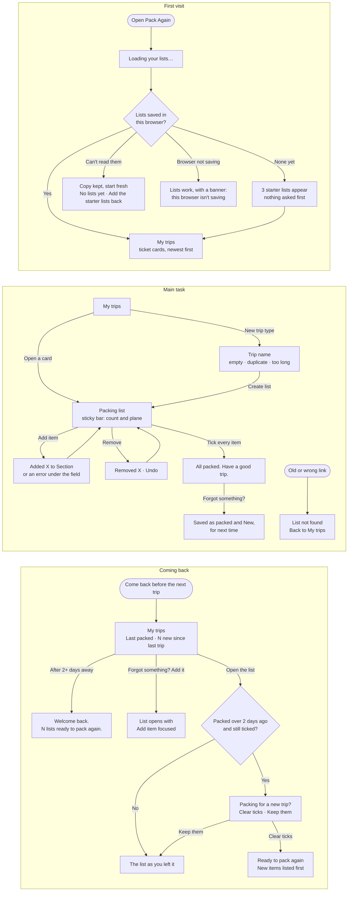

# Pack Again

Pack Again is a packing list for trips you take again and again: a weekend at your parents', a conference, a beach weekend. If you rebuild the same list from memory each time and forget the same things, Pack Again keeps the list for you. Open it, tick items off as you pack, add anything you forgot for next time, and find the list ready when the next trip comes around. There's no account and nothing to set up: three starter lists are there on your first visit.

Live: https://design-assigment3.vercel.app

## Flows

First visit, main task, coming back. Notes: [flows.md](flows.md).



## Run it locally

You need Node.js 20 or newer.

```bash
npm install
npm run dev
```

Then open http://localhost:3000. `npm run check:contrast` checks the color contrast of every pair the app uses.

## First-run check

An AI agent used the live app as a first-time user, judging only from the screen: first visit, adding items (including an empty submit and a duplicate), ticking, removing, finishing a list, adding something forgotten, coming back in a new tab and a new browser session, at 1440px and 390px, and once with the keyboard only. It had built the app itself, so it wasn't a truly fresh user; treat this as a first pass before testing with people.

**Summary.** Useful within about 5 seconds and two clicks, with no sign-up and realistic starter lists. You always know where you are, errors appear under the field and keep what you typed, ticks don't rely on color, the lists are remembered across tabs and browser restarts, and the keyboard flow works. The weak spots were feedback you can't see and changes you can't take back.

**The 5 problems, most severe first**

1. **Removing was instant and permanent.** After a removal, the next row's Remove slid under the pointer, so a second click deleted another item.
2. **The "forgot last time" memory was fragile.** Unticking and re-ticking any item in a fully packed list erased every New mark, so "N new since last trip" never showed.
3. **"All packed" appeared off screen.** It showed at the top of the page while you ticked the last item at the bottom.
4. **No visible confirmation when adding.** An item added to a section further down appeared off screen; the "Added" message was only for screen readers.
5. **Errors didn't say what to do and lingered.** "Sunscreen is already in Toiletries" gave no next step, and old errors stayed on screen after moving on.

**What I changed**

| Problem | Decision | What changed |
|---|---|---|
| 1. Permanent removal | Fixed | "Removed Socks." with an Undo button, until your next change. Undo puts the item back in its place. |
| 2. New marks erased | Fixed | New marks now clear only when the next trip is packed (after Clear ticks), not when you re-tick within the same trip. |
| 3. Success off screen | Fixed | The count, plane and "All packed" sit in a bar that sticks to the top as you scroll. |
| 4. No add confirmation | Fixed | The bar shows "Added Sunglasses to Other" on screen, not only to screen readers. |
| 5. Errors | Fixed | "…is already in Toiletries. Tick it there or use another name". Errors clear when the form changes or you leave an empty field. |
| On phones the form sits above the list | Left for now | The list is reachable by scrolling and the bar shows progress; collapsing the form is a bigger layout change. |
| Item names can't be edited | Left for now | Remove and add again works, and Undo makes removing safe. Editing would add a form state to every row. |
| Extra Tab stop after opening a list with Enter | Left for now | Seen only in headless Chrome; needs checking in a real browser first. |
| Confusing copy ("New trip type", codes like WEP) | Left for now | Worth a wording pass with real users rather than guessing. |

## What it remembers

Everything stays in your browser's local storage under `pack-again:v1`: your lists, their items and sections, which items are ticked or marked New, when each list was last packed, when you cleared the ticks, and whether you answered "Packing for a new trip?". If saved data can't be read, a copy is kept under `pack-again:backup` before starting fresh.

Nothing leaves your device: no account, no server, no analytics, and the fonts are bundled with the app. Lists don't sync to other browsers or devices, and clearing your browser's site data deletes them.
