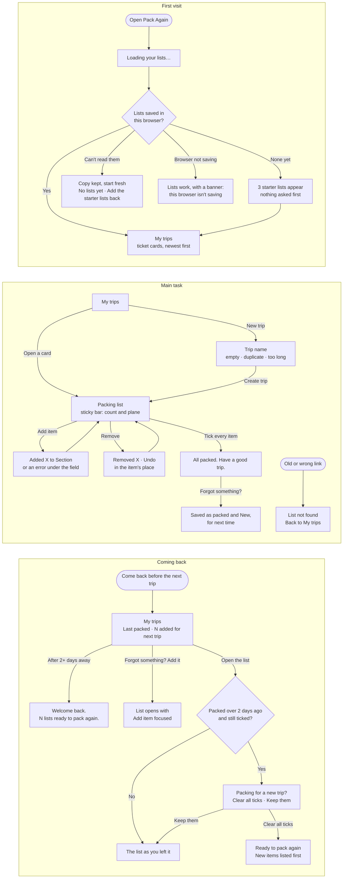

# Pack Again

Pack Again is a packing list for trips you take again and again: a weekend at your parents', a conference, a beach weekend. If you rebuild the same list from memory each time and forget the same things, Pack Again keeps the list for you. Open it, tick items off as you pack, add anything you forgot for next time, and find the list ready when the next trip comes around. There's no account and nothing to set up: three starter lists are there on your first visit.

Live: https://design-assigment3.vercel.app

## Flows

First visit, main task, coming back. Notes: [flows.md](flows.md).



## Run it locally

You need Node.js 20 or newer.

```bash
npm install
npm run dev
```

Then open http://localhost:3000. `npm run check:contrast` checks the color contrast of every pair the app uses.

## First-run check

An AI agent used the live app twice as a first-time user, judging only from the screen: first visit, adding items (including an empty submit and a duplicate), ticking, removing, finishing a list, adding something forgotten, coming back in a new tab, at 1440px and 390px, and once with the keyboard only. It had built the app itself, so it wasn't a truly fresh user; treat this as a first pass before testing with people.

**Summary.** Useful within about 5 seconds and two clicks, with no sign-up and realistic starter lists. You always know where you are, errors appear under the field and keep what you typed, ticks don't rely on color, the lists are remembered, and the keyboard flow works. The first round's weak spots were feedback you can't see and changes you can't take back; the second round found smaller issues with keyboard reach, visual cues and wording.

**Round 1: the 5 problems, most severe first**

1. **Removing was instant and permanent.** After a removal, the next row's Remove slid under the pointer, so a second click deleted another item.
2. **The "forgot last time" memory was fragile.** Unticking and re-ticking any item in a fully packed list erased every New mark, so the count on My trips never showed.
3. **"All packed" appeared off screen.** It showed at the top of the page while you ticked the last item at the bottom.
4. **No visible confirmation when adding.** An item added to a section further down appeared off screen; the "Added" message was only for screen readers.
5. **Errors didn't say what to do and lingered.** "Sunscreen is already in Toiletries" gave no next step, and old errors stayed on screen after moving on.

**Round 2: the 5 problems, most severe first**

1. **Undo was hard to reach with the keyboard.** It lived only in the bar at the top, several Shift+Tab presses away.
2. **After opening a list with the keyboard, the first Tab landed on nothing visible.**
3. **"Forgot something?" was far from where you finish.** The form is at the top; you tick the last item at the bottom.
4. **The success icon looked like a checkbox.** A filled square with a tick, like a ticked item.
5. **Old messages stayed in the bar.** "Added…" stayed up while a new error appeared under the field.

**What I changed**

| Problem | Decision | What changed |
|---|---|---|
| Permanent removal | Fixed | "Removed Socks." with Undo in the bar, and a "Removed Socks · Undo" row in the item's place, with Undo focused. Both disappear 5 seconds after you move away from them (hovering or keyboard focus keeps them), or at your next change. Undo puts the item back and focuses it. |
| New marks erased | Fixed | New marks clear only when the next trip is packed (after Clear all ticks), not when you re-tick within the same trip. |
| Success off screen | Fixed | The count, plane and "All packed" sit in a bar that sticks to the top as you scroll. |
| No add confirmation | Fixed | The bar shows "Added Sunglasses to Other" on screen, not only to screen readers. |
| Errors | Fixed | "…is already in Toiletries. Tick it there or use another name". Errors clear when the form changes or you leave an empty field. |
| Lost Tab stop on arrival | Fixed | Opening a list moves focus to its name, so the next Tab reaches Back to My trips. |
| Old bar messages | Fixed | A new form error clears the previous message from the bar. |
| Success icon like a checkbox | Fixed | "All packed" now shows the plane icon. |
| "Forgot something?" far away | Fixed | A "Forgot something? Add it" link next to "All packed" takes you to the Add item field. |
| Confusing copy and naming | Fixed | One name for creating a trip: "New trip", "Trip name", "Create trip". Cards say "N added for next trip"; both buttons say "Clear all ticks". |
| Codes like WEP looked meaningful | Fixed | The 3-letter codes are smaller and decorative; the list name is the main text. |
| Bar line wider than the cards | Fixed | The bar's divider now matches the card width. |
| Empty space beside New trip | Fixed | New trip lines up with the cards when there's no intro line. |
| On phones the form sits above the list | Left for later | The list is reachable by scrolling and the bar shows progress; collapsing the form is a bigger layout change. |
| Item names can't be edited | Left for later | Remove and add again works, and Undo makes removing safe; editing would add a form state to every row. |

**Choices I made along the way**

- An empty list still focuses the Add item field when it opens, instead of the list name, because typing the first item is the only thing to do there.
- "Forgot something? Add it" is a button styled as a link, because it moves focus within the page rather than going to another page.

## What it remembers

Everything stays in your browser's local storage under `pack-again:v1`: your lists, their items and sections, which items are ticked or marked New, when each list was last packed, when you cleared the ticks, and whether you answered "Packing for a new trip?". If saved data can't be read, a copy is kept under `pack-again:backup` before starting fresh.

Nothing leaves your device: no account, no server, no analytics, and the fonts are bundled with the app. Lists don't sync to other browsers or devices, and clearing your browser's site data deletes them.
