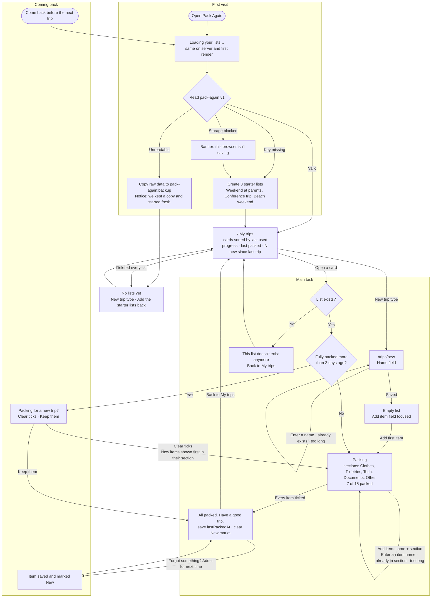

# Flows

First visit → main task → coming back. Routes: `/` My trips, `/trips/new` New trip type, `/trips/[id]` Packing list.

## Notes

- Starter lists are created only when the key is missing, never over unreadable data.
- An item added from "Forgot something?" is saved as already packed, so the list stays "All packed" for the trip you just took. It shows as New until the list is fully packed again.
- The "new trip?" prompt depends on today's date, so it is decided only after the page mounts.
- The Add item section starts on the last section picked on that page (not stored).
