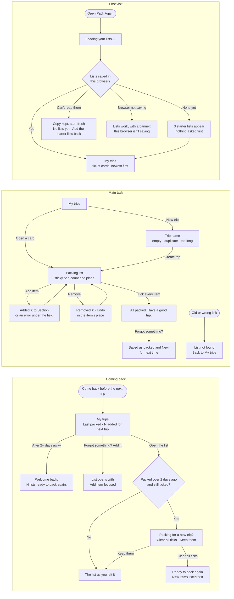

# Flows

First visit → main task → coming back. Routes: `/` My trips, `/trips/new` New trip, `/trips/[id]` Packing list.

## Notes

- Starter lists are created only when the key is missing, never over unreadable data.
- An item added from "Forgot something?" is saved as already packed, so the list stays "All packed" for the trip you just took. It stays New until the next trip is packed: after the ticks are cleared, not when items are re-ticked within the same trip.
- The "new trip?" prompt depends on today's date, so it is decided only after the page mounts.
- The Add item section starts on the last section picked on that page (not stored).
- Removing an item is immediate, with Undo in the progress bar until the next change.
